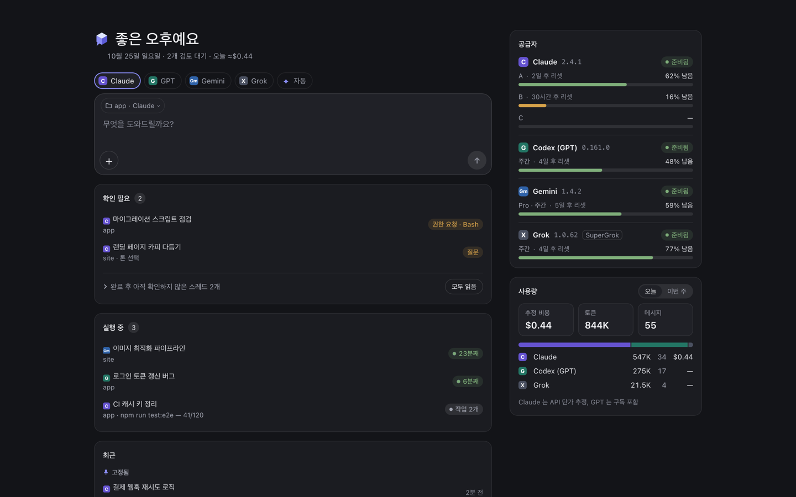

# AI-MSG

[](https://github.com/junheony/ai-msg/actions/workflows/ci.yml)
[](LICENSE)

[English](README.md) | 한국어

**AI-MSG — 모든 코딩 에이전트를 한 받은편지함에서.** Claude Code, Codex, Gemini, Grok 을 나란히 두고, 한 곳이 한도에 걸려도 작업은 이어집니다 — 책상에서도, 폰에서도.

자기 컴퓨터에서 돌리는 셀프 호스팅 도구입니다. 이미 설치하고 로그인해 둔 공식 CLI 를 그대로 구동합니다. 무료 오픈소스(Apache-2.0).



AI-MSG is an independent project, not affiliated with or endorsed by Anthropic, OpenAI, Google or xAI. Product names are trademarks of their owners.

## 기능

- **받은편지함 하나, 벤더 넷** — Claude Code·Codex·Gemini·Grok 세션을 프로젝트별로 한 목록에. 각 CLI 에서 시작한 대화도 함께 보입니다. 고정, 이름 바꾸기, 보관, 검색, 분기, 삭제(되돌리기 가능), 마크다운 내보내기.
- **한도에서도 이어지는 작업** — 에이전트가 한도에 걸리면 쓰고 있는 다른 AI 로 턴을 이어 가고, 한도가 풀리면 다시 보냅니다. 둘 다 설정에서 고르며, Gemini·Grok 은 보내도 된다고 동의한 뒤에만 쓰입니다.
- **자동 분배(Auto routing)** — Auto 가 첫 메시지와 남은 한도를 보고 엔진과 모델을 고르고, 왜 골랐는지 턴에 보여 줍니다.
- **남은 사용량** — 계정·벤더마다 남은 양과 리셋 시각, 그리고 로컬 기록으로 만든 토큰 사용 이력.
- **분할 보기** — 세션 2~4개를 나란히, 각자 따로 대화하고 배치를 저장합니다. 좁은 화면에서는 패널 하나와 서랍형 사이드바.
- **엔진마다 다른 승인** — Claude Code·Grok 은 권한이 필요한 도구 호출마다 묻습니다: 한 번만 또는 이 세션 동안 허용, 거부, 질문에 답하기. Codex 는 승인 카드 없이 샌드박스 안에서 돕니다(네트워크가 되는 작업 폴더 쓰기, 또는 읽기 전용). Gemini 는 읽기 전용이거나 작업 폴더의 파일 편집만 하고 셸 명령은 거부됩니다. 답한 카드는 모두 감사 로그에 남습니다.
- **폰에서도** — Tailscale 로 폰·태블릿에서 같은 화면을 엽니다. 브라우저가 끊겨도 턴은 서버에서 계속 돌고, 다시 붙은 기기는 놓친 것만 받습니다.
- **푸시 알림과 다시 알림** — 확인이 필요할 때 브라우저와 폰(최대 20개)으로 웹 푸시: 승인·질문이 기다리거나, 턴이 실패했거나 오래 걸렸거나 질문으로 끝났을 때. 답하지 않은 승인은 10분 뒤에, 실패한 턴은 실패 후 10·40·100분 뒤 최대 세 번 다시 알립니다. HTTPS 가 필요합니다([원격 접속](#원격-접속) 참고).
- **새 세션으로 이어가기(Handoff)** — 대화가 길어지면 옛 세션이 쓴 인계 메모를 들고 새 세션에서 이어 갑니다.
- **Commander** — 선택 기능, 기본 꺼짐: 세션에 목표와 완료 조건을 주면 턴마다 이어 가고, 승인이 필요하거나 되돌리기 어려운 단계, 턴 상한에서 멈춥니다.
- **끼워 넣기와 대기열** — 턴이 도는 중에 보낸 메시지는 다음 도구 경계에서 들어가거나 턴이 끝난 뒤로 미뤄집니다.
- **간결 모드(Concise mode)** — 기본 켜짐: 엔진·모델을 알리는 짧은 메모, 결과 먼저, 생각과 도구 출력은 접힘. 끄면 전체 스트림을 봅니다.
- **채팅 셸** — 스트리밍 마크다운, 접을 수 있는 도구 호출, diff 보기, 할 일 패널, 이미지·파일 첨부, 슬래시 명령·파일 경로 자동완성.
- **Claude 계정 여러 개** — Claude 계정이 여럿이면 계정마다 사용량을 보여 주고, 세션을 한 계정에 고정할 수 있으며, 한도에서 계정 사이를 옮기는 것은 직접 켜는 설정입니다. [Claude 계정 여러 개 쓰기](#claude-계정-여러-개-쓰기) 참고.

## 설치

Node.js 24 이상, macOS 또는 Linux, 그리고 로그인해 둔 Claude Code·Codex·Gemini(Antigravity)·Grok CLI 중 하나 이상이 필요합니다.

```bash
npx ai-msg
```

> **npm 에 아직 없습니다:** 패키지를 아직 올리지 않아 위 한 줄은 지금은 동작하지 않습니다. 저장소에서 직접 실행하세요 — [CONTRIBUTING.md](CONTRIBUTING.md#run-from-the-repository) (영어). <!-- npm-pending -->

터미널에 로그인 주소가 나옵니다. 그 주소를 열면 첫 실행 마법사가 어떤 CLI 가 설치되고 로그인돼 있는지 보여 줍니다. 계속 켜 두려면 `npm i -g ai-msg` 뒤 `ai-msg service install` (macOS 는 launchd, Linux 는 systemd 사용자 서비스).

CLI 별 로그인, 언어, 폰 접속, 서비스, 업그레이드, 삭제, 문제 해결을 담은 전체 안내는 [docs/install.ko.md](docs/install.ko.md) 입니다.

## Pro (출시 예정)

Community — 이 페이지의 모든 기능 — 는 무료 오픈소스이며 기능 잠금이 없습니다. Pro 는 출시 예정이며, 책상을 떠나 일하는 사람을 위한 것이고 아직 판매하지 않습니다. 종단간 암호화 릴레이를 더해, Tailscale·HTTPS 설정 없이 어디서든 폰에서 세션을 이어 보고 승인할 수 있게 하고, 푸시와 다시 알림도 릴레이로 보냅니다. 가격은 월 $10 또는 연 $100 입니다.

클라우드 계정에 이 컴퓨터를 연결하지 않으면 클라우드로 나가는 것은 없습니다. `DECK_CLOUD=off` 면 클라우드 기능이 완전히 꺼집니다. 자세한 내용: [docs/security-model.md](docs/security-model.md), [docs/privacy-data-inventory.md](docs/privacy-data-inventory.md).

## Claude 계정 여러 개 쓰기

계정 하나가 Claude Code **프로필 디렉터리** 하나다. 프로필마다 한 번씩 로그인한다.

```bash
claude auth login                         # 첫 계정   -> ~/.claude
CLAUDE_CONFIG_DIR=~/.claude-b claude auth login # 둘째 계정 -> ~/.claude-b
CLAUDE_CONFIG_DIR=~/.claude-c claude auth login # 셋째 계정 -> ~/.claude-c  (계정 수는 제한 없음)
```

`accounts.json` 이 없으면 시작할 때 자동으로 찾는다. `~/.claude` 는 계정 `a`, `~/.claude-<영문 소문자 한 글자>` 는 그 글자의 계정이 된다. `.claude-<x>` 는 안에 `projects` 디렉터리나 `.claude.json` 이 있을 때만 센다. 그 밖의 `~/.claude-*` 이름(`.claude-backup`, `.claude-2` 등)은 무시하고, 시작 로그에 그 디렉터리를 추가할 `accounts.json` 항목을 한 줄씩 알려 준다. 계정은 하나만 있어도 동작하고, 아무것도 없으면 `a` 하나다.

다른 id 나 디렉터리를 쓰거나, 이름을 붙이거나, 홈 계정을 바꾸거나, 계정을 빼려면 `<설정 디렉터리>/accounts.json`(기본 `~/.config/deck/accounts.json`)을 만든다.

```json
{
  "version": 1,
  "home": "a",
  "accounts": [
    { "id": "a", "label": "Main" },
    { "id": "work", "label": "Work", "configDir": "~/.claude-work" },
    { "id": "side", "configDir": "/Users/alice/profiles/side", "card": "claude:side-project" },
    { "id": "old", "label": "Old", "retired": true }
  ]
}
```

| 필드 | 기본값 | 뜻 |
|---|---|---|
| `version` | 필수 | `1` 이어야 한다. |
| `id` | 필수 | 바뀌지 않는 키, `^[a-z0-9][a-z0-9_-]{0,15}$`. 세션과 함께 저장된다. 쓸 수 없는 이름: `gpt`, `g1`, `g2`, `x1`, `x2`, `grok`, `codex`, `all`, `auto`, `none`, `null`, `undefined`, `constructor`. |
| `label` | `id` 의 대문자 | 화면에 보이는 이름(1~40자). |
| `configDir` | `a` 는 `~/.claude`, 그 밖은 `~/.claude-<id>` | 프로필 디렉터리. 절대 경로이거나 `~/` 로 시작. |
| `card` | `a`·`b`·`c` 는 `claude:main`·`claude:second`·`claude:third`, 그 밖은 `claude:<id>` | 선택 사항인 사용량 대시보드의 카드 id([사용량 자료](#사용량-자료) 참고). |
| `retired` | `false` | 읽기 전용. 세션과 사용량은 계속 보이지만 라우팅·계정 선택기·고정에서 빠진다. 이 계정의 세션을 이어 가려 하면 안내 문구와 함께 거부된다. |
| `home`(최상위) | `a` 가 쓸 수 있으면 `a`, 아니면 첫 번째 쓸 수 있는 계정 | Claude Desktop 이 읽고 쓰는 프로필 하나. 다른 계정에서 돌린 세션을 여기로 미러링한다. 쓸 수 있는(retired 가 아닌) 계정이어야 한다. |

쓸 수 있는 계정이 최소 하나는 있어야 한다. 모르는 필드는 무시한다.

**파일이 있는데 잘못됐으면**(읽을 수 없음, JSON 아님, 형식 오류, id·디렉터리·card 중복, 없는 `home`, 상대 경로 `configDir`) 서버는 시작하지 않고 파일 경로와 이유를 출력한다. 자동 발견으로 넘어가지 않는다. 파일이 말하는 것과 다른 계정 구성으로 조용히 도는 것을 막기 위해서다. 파일이 없을 때만 자동 발견을 한다.

### 계정 추가

1. 새 프로필 디렉터리에 Claude Code CLI 로 직접 로그인한다. 예: `CLAUDE_CONFIG_DIR=~/.claude-work claude auth login`.
2. `accounts.json` 에 항목을 추가한다. 파일이 없고 `~/.claude-d` 처럼 한 글자 접미사라면 항목이 필요 없다.
3. 서버를 다시 시작한다.

### 계정 빼기

- **`"retired": true`** — 세션과 사용량이 읽기 전용으로 계속 보인다. 기록을 남기려면 이쪽을 쓴다.
- **항목을 지우기** — 그 계정의 `projects` 디렉터리를 더 이상 읽지 않으므로 세션이 목록에서 사라진다. 디스크의 파일은 그대로다. 남겨서 보려면 `retired` 를 쓴다.

주의:

- `id` 를 바꾸거나 두 계정의 `configDir` 을 맞바꾸면 사용량 집계가 겹쳐 실제보다 높게 나올 수 있다. id 는 바꾸지 않는다.
- 토큰 사용량 인덱스가 다루는 Claude 계정은 뺀 계정·지운 계정을 포함해 평생 최대 23개다. 넘치는 계정은 로그에 한 번 알리고 세지 않는다.

**Claude Desktop** 미러링 대상은 최상위 `home` 계정 하나다.

**보호 계정.** 한 계정을 직접(예: Claude Desktop 에서) 같이 쓴다면 보호 계정으로 지정한다. 자동 라우팅은 그 계정도 사용량으로 똑같이 순위를 매기되, 후보가 비슷할 때만 가장 나중에 쓴다. `accounts.json` 이 아니라 별도로 지정한다. `CLAUDE_PROTECT=<id>` 로 지정한다. 설정에 없는 계정 id 는 시작 로그에 경고를 남기고 무시한다. 세션을 보호 계정에 고정하는 것은 그대로 된다 — 고정은 사용자가 직접 고른 것이기 때문이다.

**같은 벤더 계정 순환은 기본 꺼짐.** 세션은 홈 계정이나 직접 고정한 계정에 머뭅니다. 설정에서 켜면 본인이 결제하는 본인 계정이라는 확인을 거친 뒤에만, 한도·Fable 상한·식은 캐시 때 다른 Claude 계정으로 옮깁니다. 다른 벤더로 이어 가기는 별개의 설정입니다.

### 턴이 계정을 받는 방법 (순환을 켠 경우)

1. 고정된 세션은 고정 계정을 쓴다. 그 계정이 한도에 닿았거나 쿨다운 중일 때만 예외다.
2. 그 밖에는 프롬프트 캐시가 따뜻한 동안(마지막 턴 후 55분 미만) 지금 계정에 머문다.
3. 지금 계정이 5시간 창 80% 또는 주간 창 85% 를 넘거나 쿨다운 중이면 옮긴다. 95% 이상인 계정은 후보에서 빠진다.
4. 새 세션과 캐시가 식은 세션은 가장 좋은 후보로 간다. 정책은 설정에서 고른다: *고르게 분산*(기본, 5시간 사용률이 낮은 계정 먼저) 또는 *리셋 임박 먼저 소진*(주간 창이 가장 빨리 리셋되는 계정 먼저).
5. 턴이 한도 오류나 인증 오류로 실패하면 그 계정을 쿨다운에 넣고(1시간 / 6시간), 세션 기록을 다음 계정의 프로필로 복사해 거기서 다시 시도한다(재시도 최대 2회).

턴마다 뱃지에 계정, 모델, 그렇게 고른 이유가 표시된다.

## 엔진

| 엔진 | 실행 방식 | 승인과 참고 |
|---|---|---|
| Claude Code | 공식 `claude` CLI 헤드리스, 턴마다 프로세스 하나, 고른 프로필로 | 승인·질문 카드. 세션별 모드(매번 묻기, 편집 자동 승인, 계획, 모두 자동 승인). Claude Code 설정·허용/거부 규칙·훅이 CLI 와 똑같이 적용됩니다. |
| Codex | `codex exec --json` (codex-cli 0.159 이상) | Codex 는 승인 카드 없이 `approval_policy=never` 와 샌드박스로 돕니다 — 기본은 네트워크가 되는 작업 폴더 쓰기, 또는 읽기 전용. 세션의 샌드박스 칩에서 바꾸면 다음 턴부터 적용됩니다. `danger-full-access` 는 쓰지 않습니다. |
| Gemini | Antigravity CLI `agy` 헤드리스 | 읽기 전용이거나 작업 폴더 편집만(셸 명령 거부). Auto 는 동의한 뒤에만 씁니다. 다시 연 세션에는 이전 메시지가 보이지 않습니다. 로그인과 한계: [docs/gemini-spike.md](docs/gemini-spike.md). |
| Grok | `grok agent`(Grok Build CLI)를 ACP 로, 턴마다 프로세스 그룹 하나 | 승인 카드, 모두 자동 승인·편집 자동 승인 모드, 턴 도중 메시지, 감사 로그. Auto 는 동의한 뒤에만 씁니다. 사용량 카드가 CLI 가 알리는 구독 사용량을 보여 줍니다. 이미지 첨부는 거부됩니다. |

세션의 엔진은 만들 때 정해집니다. CLI 바이너리가 없으면 그 엔진은 숨겨집니다(Grok 은 흐리게 보임). Auto 가 고른 엔진이 일을 할 수 없으면(Gemini 의 셸, Grok 의 이미지) 보내기 전에 묻습니다.

**Grok 주의.** Grok CLI 는 프로젝트의 `.grok/` 설정을 읽는데, 이것이 권한을 바꾸거나 명령을 실행할 수 있습니다. 직접 만들지 않은 `.grok/` 가 있는 폴더에서는 Grok 세션을 시작하지 마세요(AI-MSG 는 감지할 수 있는 곳에서 거부합니다). AI-MSG 는 Grok 의 모든 승인 요청에 세션 모드대로 직접 답하고, 턴 전에 `grok inspect --json` 으로 권한 규칙·`default` 가 아닌 기본 모드·자동 모드가 보이면 그 턴을 거부합니다. `default` 모드에서도 Grok CLI 는 읽기 도구, 읽기 전용 셸 명령, `mkdir`, `touch` 를 묻지 않고 실행합니다. 물었어야 할 도구가 요청 없이 실행되면 AI-MSG 는 턴을 멈추고 설정에서 풀기 전까지 Grok 엔진을 잠급니다. Grok 이 알리는 것에 대한 최선의 확인이지 샌드박스가 아닙니다. Grok 턴은 `HOME` 을 빈 새 폴더로 두고 돕니다(`.gitconfig`, `.config/git`, `.ssh` 만 연결). 같은 Grok 세션을 터미널에서 동시에 열지 마세요.

## 원격 접속

기본으로 서버는 `127.0.0.1` 과, 이 컴퓨터의 **Tailscale** IPv4 주소라고 판단한 주소에서 듣는다. `0.0.0.0` 에는 절대 바인드하지 않는다.

이름이 `utunN`(macOS) 또는 `tailscaleN`(Linux)인 인터페이스에 있는 `100.64.0.0/10` 범위의 IPv4 주소를 Tailscale 주소로 본다. `tailscale` CLI 가 설치돼 있고 응답하면 그 주소가 `tailscale ip -4` 결과에도 있어야 한다. CLI 가 없거나 실패하면 이 대조는 건너뛰고 인터페이스 이름과 대역만으로 판단한다.

> 다른 VPN 도 `utunN` 인터페이스를 쓰고, 일부는 `100.64.0.0/10` 대역을 쓴다. 그런 VPN 을 쓰는 환경이라면(특히 `tailscale` CLI 가 없다면) `DECK_LOOPBACK_ONLY=1` 로 그 네트워크에서 듣지 않게 한다.

- tailnet 의 다른 기기에서: `http://<tailscale-ip>:9320`.
- `Host` 헤더가 루프백, 바인드한 주소, 이 노드의 MagicDNS 이름, `DECK_EXTRA_HOSTS` 중 하나일 때만 요청을 받는다.
- Web Push 와 PWA 설치는 HTTPS 가 필요하다. `tailscale serve` 뒤에 둔다. 예: `tailscale serve --bg --https=443 http://127.0.0.1:9320` 후 `https://deck-host.example.ts.net/` 을 연다.

포트를 공개 인터넷에 열지 않는다. 다중 사용자 지원이 없고, 로그인 시도 횟수 제한도 없다.

## 보안 모델

AI-MSG 는 내 컴퓨터에서 명령을 실행할 수 있습니다. 여기에 접속할 수 있다는 것은 셸에 접속할 수 있다는 것과 같다고 보세요.

- **내 코드가 가는 곳.** 쓰고 있는 CLI 의 벤더 — 터미널에서 쓸 때와 같습니다. 우리 쪽으로는 가지 않습니다. 한도에서 이어 가기를 켰다면 이어 가는 턴은 다른 벤더의 CLI 로도 갑니다.
- **누가 접속할 수 있나.** 이 컴퓨터의 프로세스와 내 tailnet 의 기기. 로그인을 뺀 모든 `/api` 요청과 WebSocket 은 세션 쿠키가 있어야 합니다.
- **토큰.** `~/.config/deck/token`(`0600`)의 16진수 64자. 브라우저는 SHA-256 으로 파생한 쿠키만 갖습니다(`HttpOnly`, `SameSite=Strict`, HTTPS 에서는 `Secure`), 30일 유지.
- **교차 사이트 요청.** 상태를 바꾸는 요청과 WebSocket 업그레이드는 서버 자신의 `Origin` 이 있어야 합니다. `Host` 허용 목록이 DNS 리바인딩을 막고, 응답에는 제한적인 Content-Security-Policy 가 붙으며, 모델 출력의 이미지는 불러오지 않고 링크로 그립니다.
- **엔진마다 다른 승인.** Claude Code·Grok 은 권한이 필요한 도구 호출마다 묻고, 새 Claude 세션은 *매번 묻기* 로 시작합니다. Codex 는 승인 카드 없이 샌드박스에서 돕니다. Gemini 는 읽기 전용이거나 편집만 합니다. 다른 엔진으로 이어 가는 턴도 세션이 허용한 것 이상은 받지 못합니다. 답하지 않은 요청은 30분이 지나거나 턴이 끝나면 거부됩니다.
- **"모두 자동 승인"은 직접 켜는 선택 사항.** 켜면 셸 명령·파일 편집·네트워크 접근을 포함한 모든 도구 호출이 카드 없이, 어느 기기에서든, 아무도 보고 있지 않아도 실행됩니다. 호출은 감사 로그에 남고 거부 규칙과 훅은 계속 적용됩니다.
- **감사 로그.** 모든 권한 결정이 `~/.config/deck/audit.log` 에 JSON 한 줄씩 쌓입니다: 시각, 세션, 도구 이름, 결정, 누가 결정했는지, 도구 입력의 SHA-256(입력 자체는 남기지 않음). 5 MiB 에서 넘어갑니다.
- **자격 증명.** AI-MSG 는 CLI 의 자격 증명을 읽거나 저장하거나 전달하지 않습니다. 프로필 디렉터리를 골라 공식 CLI 를 띄울 뿐입니다. Claude 턴 전에 자식 환경에서 `ANTHROPIC_API_KEY`, `CLAUDE_CODE_OAUTH_TOKEN`, `ANTHROPIC_AUTH_TOKEN`, 베이스 URL 변수를 지워 턴이 조용히 다른 계정으로 과금되지 않게 합니다.
- **파일 접근.** 새 세션은 홈 디렉터리 안에서만 시작할 수 있습니다. 파일 미리보기 API 는 설정 디렉터리, 홈 바로 아래의 점(.) 디렉터리, 흔한 비밀 파일(`.env`, 개인 키, 자격 파일)을 거부합니다.

취약점은 [SECURITY.md](SECURITY.md) 대로 제보하세요.

## 설정

설정은 모두 환경변수이고 필수인 것은 없습니다.

| 변수 | 기본값 | 설명 |
|---|---|---|
| `DECK_PORT` | `9320` | 듣는 포트(`ai-msg --port N` 도 같음). |
| `DECK_CONFIG_DIR` | `~/.config/deck` | 토큰, `accounts.json`, 설정, 세션 상태, 감사 로그, 첨부, 사용량 파일. 폴더 하나에 서버 하나. |
| `DECK_LANG` | `LC_ALL`/`LC_MESSAGES`/`LANG` 에서, 없으면 `en` | 설정에서 언어를 고르기 전까지 서버 문구의 언어(`en` 또는 `ko`). |
| `DECK_LOOPBACK_ONLY` | 미설정 | `1` 이면 Tailscale 이 떠 있어도 `127.0.0.1` 에서만 듣습니다. |
| `DECK_EXTRA_HOSTS` | 없음 | `Host` 헤더로 추가 허용할 이름(콤마 구분). |
| `DECK_STEER` | 켜짐 | `0` 이면 턴 도중 보낸 메시지를 끼워 넣지 않고 턴 뒤로 미룹니다. |
| `DECK_DRAIN_MAX_MIN` | 미설정이면 실행 중인 일이 끝날 때까지, 서비스는 25 | 정지·재시작 때 돌고 있는 턴과 백그라운드 작업을 기다리는 최대 분. 그때까지 안 끝난 일은 끊고 그 세션에 알립니다. |
| `DECK_BG_MAX_MIN` | `360` | 턴이 끝난 뒤 백그라운드 작업 때문에 CLI 프로세스를 열어 두는 최대 분. |
| `DECK_BACKUP_RETENTION_DAYS` | `30` | 분기 백업과 삭제한 세션을 지우는 기준 일수. |
| `DECK_USAGE_SOURCE` | `cli` | Claude 사용량의 출처: `cli`(CLI 가 턴마다 내는 출력) 또는 `usage-deck`(`DECK_URL` 의 외부 대시보드). [사용량 자료](#사용량-자료) 참고. |
| `DECK_USAGE_STRICT` | 미설정 | `1` = 잔여량 모름 → Opus·엔진 전환, `0` = 전환 안 함. |
| `DECK_URL` | `http://127.0.0.1:9310` | 선택 사항인 사용량 대시보드의 주소. |
| `CLAUDE_PROTECT` | 미설정 | 보호 계정 id. |
| `DECK_CLAUDE_BIN`, `DECK_CODEX_BIN`, `DECK_GEMINI_BIN`, `DECK_GROK_BIN` | `PATH` 탐색 | CLI 경로. |
| `CODEX_HOME` | `~/.codex` | Codex 세션 롤아웃을 읽는 위치. |
| `DECK_DESKTOP_SESSIONS_DIR` | `~/Library/Application Support/Claude/claude-code-sessions` | Claude Desktop 세션 기록(읽기 전용). |
| `DECK_VAPID_SUBJECT` | 자동 | Web Push 의 `https:` 또는 `mailto:` subject. |
| `DECK_UI_DIR` | 빌드된 UI | 빌드된 UI 디렉터리. |
| `DECK_CLOUD` | 켜짐 | `off` = 클라우드를 완전히 끔: 아무것도 보내지 않습니다. |

화면에서 바꾸는 서버 전체 설정(기본 권한 모드, 라우팅 정책, 같은 벤더 계정 순환, 언어)은 설정 디렉터리의 `settings.json` 에 저장됩니다.

### 사용량 자료

Claude 사용량 카드의 출처는 둘이고 `DECK_USAGE_SOURCE` 로 고른다.

- **`cli` (기본).** 사용량 엔드포인트를 전혀 호출하지 않는다. 계정별 5시간·주간 값은 AI-MSG 가 그 계정으로 돌린 턴에서 공식 `claude` CLI 가 내는 `rate_limit_event` 에서만 얻는다. 마지막 값과 관측 시각은 계정별로 `<설정 디렉터리>/claude-usage-observed.json`(권한 0600)에 저장되어 재시작 뒤에도 남는다. 카드에는 언제 관측했는지("마지막 턴 기준 · 12분 전")가, 관측이 없는 계정에는 "아직 관측 없음"이 보인다. 리셋 시각이 지난 창은 0% 로 보되 "추정"으로 표시한다. 한 창 안의 사용량은 줄지 않으므로, 관측 뒤 10분이 지나도 그 값은 창들 중 가장 이른 리셋 시각까지(관측 뒤 최대 24시간, 리셋 시각이 없는 창은 10분) 라우팅에서 하한값으로 쓴다. 그동안 카드는 "추정 · 마지막 턴 12분 전"으로 보이고, 더 최근에 관측한 계정이 먼저 뽑힌다. 그 뒤에는 카드가 흐려지고 라우팅은 그 계정을 모름으로 본다. CLI 는 Fable 한도를 알려 주지 않으므로 Fable 잔여량은 모르는 채로 두고(Fable 행은 "CLI 미제공"), 대시보드 없는 설치와 마찬가지로 그것만으로 Fable 요청을 Opus 로 바꾸지 않는다(바꾸려면 `DECK_USAGE_STRICT=1`). CLI 가 그 계정이 초과 사용(overage) 중이라거나 Opus 계열 한도가 요청을 거절했다고 알리면, 그 한도가 리셋될 때까지 Fable 은 소진으로 보고 Fable 요청을 Opus 로 보낸다.
- **`usage-deck`.** 대시보드 주소를 설정했거나(`DECK_URL`) 기본 주소의 대시보드가 이 설치에 응답한 적이 있으면(`<설정 디렉터리>/usage-source.json` 에 기록) 자동으로, 또는 `DECK_USAGE_SOURCE=usage-deck` 으로 고른다. 아래 설명.

`usage-deck` 모드에서 AI-MSG 는 `DECK_URL` 의 외부 사용량 대시보드를 60초마다 조회해(`GET /api/state`) 계정별 사용량 창을 받는다. 대시보드는 별도 프로그램이고 이 저장소에 들어 있지 않다. 기대하는 응답은 다음과 같다.

```json
{ "cards": [ { "id": "claude:main", "status": "ok", "fetchedAt": "2026-01-01T00:00:00Z",
  "rows": [ { "label": "Session (5h)", "used": 12, "resetsAt": "2026-01-01T05:00:00Z" },
            { "label": "Weekly (7d)", "used": 40, "resetsAt": "2026-01-05T00:00:00Z" } ] } ] }
```

계정 `a`·`b`·`c` 는 카드 id `claude:main`·`claude:second`·`claude:third` 에 대응하고, 나머지 계정은 `claude:<id>` 에 대응한다. 바꾸려면 `accounts.json` 의 `card` 를 쓴다.

대시보드가 응답하지 않아도 전부 동작한다. 이때 사용량 창은 각 CLI 가 턴 도중 알려 주는 값에서 온다. 그래서 계정은 턴을 한 번 돌린 뒤에야 숫자가 보이고, 사용량을 모르는 계정은 값이 알려진 후보보다 뒤, 한도에 닿은 것으로 알려진 계정보다 앞 순위 후보가 된다. 토큰 사용 이력 화면은 로컬 기록을 읽으므로 대시보드와 무관하다.

**사용량 대시보드가 없으면 잔여량을 알 수 없고, AI-MSG 는 그 이유만으로 요청을 바꾸지 않는다.** "모름"만으로는 모델이나 엔진을 바꾸지 않는다. Fable 을 요청하면 Fable 로 실행한다. 플랜 한도를 넘는 Fable 초과 과금은 사용자가 직접 관리해야 한다. 대시보드 응답을 한 번이라도 본 설치는 엄격 모드로 `<설정 디렉터리>/usage-source.json` 에 기록되고, 대시보드 주소를 직접 설정한 설치(`DECK_URL`)는 처음부터 엄격 모드다. 이때는 잔여량 모름이 Fable 대신 Opus, 엔진 전환으로 이어진다. `DECK_USAGE_STRICT=1` 로 엄격 모드를, `DECK_USAGE_STRICT=0` 으로 느슨한 모드를 강제한다. 첫 대시보드 조회가 끝나기 전에는 엄격한 쪽으로 동작한다.

## 파일

`~/.config/deck`(또는 `DECK_CONFIG_DIR`) 아래:

| 파일 | 내용 |
|---|---|
| `token` | 로그인 토큰(`0600`). |
| `accounts.json` | 선택. 계정 목록. |
| `settings.json` | 서버 전체 설정. |
| `projects.json` | 선택. 고정 프로젝트 폴더, 예: `[{"cwd": "/Users/alice/projects/acme-web", "name": "acme-web"}]`. |
| `session-state.json`, `session-meta.json`, `pins.json`, `recent-folders.json` | 세션별 계정·모델, 제목, 보관 표시, 고정, 최근 폴더. |
| `audit.log` | 권한 결정. |
| `events.jsonl` | 끝났거나 실패한 턴, 카드, 백그라운드 작업, 재시작. 7일 보관. |
| `attachments/` | 올린 파일(`0700`, 파일당 10 MiB, 7일 뒤 삭제). |
| `vapid.json`, `push-subscriptions.json` | Web Push 키와 구독(`0600`). |
| `cloud/state.json` | 클라우드 계정에 연결한 뒤에만(`0600`). |
| `ai-msg.log` | macOS 서비스 로그. |

대화 기록은 각 CLI 가 두는 자리에 그대로 있습니다(Claude 는 `<프로필>/projects/`, Codex 는 `$CODEX_HOME/sessions`).

## 개발

저장소에서 실행하기, 개발용 서비스, 테스트, 코드 구조는 [CONTRIBUTING.md](CONTRIBUTING.md) 에 있습니다. 구조 설명: [docs/ARCHITECTURE.md](docs/ARCHITECTURE.md).

## 면책

AI-MSG 는 비공식 프로젝트입니다. Anthropic, OpenAI, Google, xAI 와 관계가 없고, 이들의 승인이나 지원을 받지 않습니다. "Claude", "Codex", "Gemini", "Grok" 은 각 소유자의 상표입니다.

사용자가 직접 설치하고 직접 로그인한 CLI 를 본인 기기에서 쓰기 위한 로컬 프런트엔드입니다. API 키를 쓰지 않고, 사람들 사이에 계정을 공유하지 않습니다. 여러 계정을 쓰는 것을 포함해, 자신의 사용이 각 서비스의 약관에 맞는지는 사용자 책임입니다.

## 라이선스

[Apache License 2.0](LICENSE). [NOTICE](NOTICE) 와 [THIRD_PARTY_NOTICES.md](THIRD_PARTY_NOTICES.md) 를 보세요.
