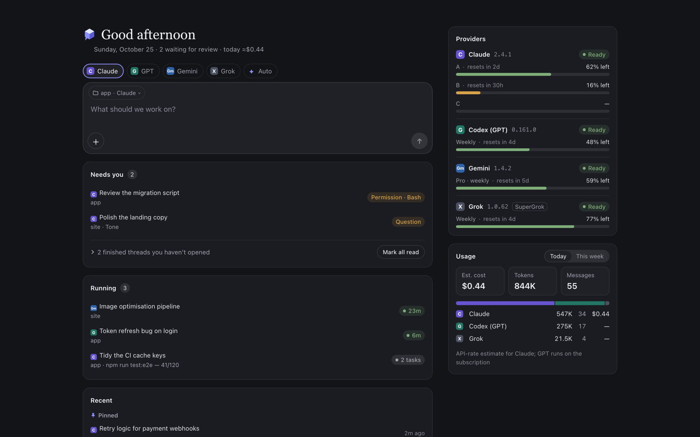

# AI-MSG

[](https://github.com/junheony/ai-msg/actions/workflows/ci.yml)
[](LICENSE)

English | [한국어](README.ko.md)

**AI-MSG — one inbox for all your coding agents.** Claude Code, Codex, Gemini and Grok side by side; when one hits its limit, the work carries on — from your desk or your phone.

It is self-hosted: AI-MSG runs on your own computer and drives the official CLIs you have already installed and logged in to, as they are. Free and open source under Apache-2.0.



AI-MSG is an independent project, not affiliated with or endorsed by Anthropic, OpenAI, Google or xAI. Product names are trademarks of their owners.

## Features

- **One inbox, four vendors** — Claude Code, Codex, Gemini and Grok sessions in one list, grouped by project, including conversations you started in those CLIs. Pin, rename, archive, search, fork, delete (with undo), export to Markdown.
- **Work carries on at the limit** — when an agent runs out, the turn continues on another AI you use, and is sent again when the limit resets. Both are settings you control; Gemini and Grok are used only after you agree to sending to them.
- **Auto routing** — Auto picks the engine and model from your first message and the limits you have left, and shows why on the turn.
- **Usage left, every account** — what is left and when it resets, per account and vendor, plus a token-usage history built from local transcripts.
- **Split view** — two to four sessions side by side, each its own conversation, with saved layouts. On a narrow screen: one pane and a drawer sidebar.
- **Approvals, engine by engine** — Claude Code and Grok ask before tool calls that need permission: approve once or for the session, deny, or answer their questions. Codex runs with no approval cards, inside its sandbox (the project folder with network access, or read-only). Gemini is read-only, or edits files in the project folder with shell commands refused. Every answered card goes to an audit log.
- **On your phone, too** — the same UI on a phone or tablet over Tailscale. Turns keep running on the server when a browser disconnects; a device that reconnects gets only what it missed.
- **Push notifications and reminders** — Web Push to up to 20 browsers and phones when something needs you: an approval or question waiting, or a turn that fails, runs long or ends with a question. An unanswered approval is pushed again after 10 minutes; a failed turn up to three more times, 10, 40 and 100 minutes after it failed. Needs HTTPS (see [Remote access](#remote-access)).
- **Handoff** — continue a long conversation in a new session with a handoff note written from the old one.
- **Commander** — optional, off by default: give a session a goal and a done condition, and it keeps going turn by turn, stopping for you on approvals, hard-to-undo steps and at a turn cap.
- **Steer and queue** — a message sent while a turn runs is added at the next tool boundary, or queued for after the turn.
- **Concise mode** — on by default: a short note naming the engine and model, results first, thinking and tool output folded away. Turn it off for the full stream.
- **Chat shell** — streaming Markdown, collapsible tool calls, diff view, todo panel, image and file attachments, slash-command and file-path completion.
- **Multiple Claude accounts** — if you have more than one Claude account, each one's usage is shown, sessions can be pinned to one, and moving between them on a limit is an opt-in setting. See [Multiple Claude accounts](#multiple-claude-accounts).

## Install

You need Node.js 24 or newer, macOS or Linux, and at least one of the Claude Code, Codex, Gemini (Antigravity) or Grok CLIs, logged in.

```bash
npx ai-msg
```

> **Not on npm yet:** the package is not published, so the line above does not work today — run AI-MSG from the repository instead, as described in [CONTRIBUTING.md](CONTRIBUTING.md#run-from-the-repository). <!-- npm-pending -->

The terminal prints a login address; open it, and the first-run setup shows which CLIs are installed and logged in. To keep it running: `npm i -g ai-msg`, then `ai-msg service install` (launchd on macOS, a systemd user service on Linux).

The full guide — logging in to each CLI, language, phone access, the service, upgrades, uninstalling and troubleshooting — is [docs/install.md](docs/install.md).

## Pro (coming soon)

Community — everything on this page — is free and open source, with no feature lock. Pro is coming soon: it is for working away from your desk and is not on sale yet. It will add an end-to-end encrypted relay, so your phone can follow sessions and approve from anywhere without setting up Tailscale or HTTPS, with push and reminders delivered through it. It will cost $10 a month or $100 a year.

Nothing is sent to the cloud unless you link this computer to a cloud account. `DECK_CLOUD=off` turns the cloud feature off entirely. Details: [docs/security-model.md](docs/security-model.md) and [docs/privacy-data-inventory.md](docs/privacy-data-inventory.md) (both in Korean).

## Multiple Claude accounts

Each account is a Claude Code **profile directory**. Log in once per profile:

```bash
claude auth login                                   # first account  -> ~/.claude
CLAUDE_CONFIG_DIR=~/.claude-b claude auth login     # second account -> ~/.claude-b
CLAUDE_CONFIG_DIR=~/.claude-c claude auth login     # third account  -> ~/.claude-c  (any number works)
```

With no `accounts.json`, AI-MSG discovers accounts at start: `~/.claude` becomes account `a`, and `~/.claude-<letter>` (one lower-case ASCII letter) becomes the account with that letter. A `.claude-<x>` directory counts only if it contains a `projects` directory or a `.claude.json`. Any other `~/.claude-*` name (`.claude-backup`, `.claude-2`) is ignored, and the start log prints the `accounts.json` entry that would add it. One account is enough; with nothing found, the account is `a`.

To use other ids or directories, name accounts, set the home account or retire one, create `<config dir>/accounts.json` (default `~/.config/deck/accounts.json`):

```json
{
  "version": 1,
  "home": "a",
  "accounts": [
    { "id": "a", "label": "Main" },
    { "id": "work", "label": "Work", "configDir": "~/.claude-work" },
    { "id": "side", "configDir": "/Users/alice/profiles/side", "card": "claude:side-project" },
    { "id": "old", "label": "Old", "retired": true }
  ]
}
```

| Field | Default | Meaning |
|---|---|---|
| `version` | required | Must be `1`. |
| `id` | required | Permanent key, `^[a-z0-9][a-z0-9_-]{0,15}$`. Stored with sessions. Not allowed: `gpt`, `g1`, `g2`, `x1`, `x2`, `grok`, `codex`, `all`, `auto`, `none`, `null`, `undefined`, `constructor`. |
| `label` | `id` in upper case | Name shown in the UI (1 to 40 characters). |
| `configDir` | `~/.claude` for `a`, else `~/.claude-<id>` | The profile directory: absolute, or starting with `~/`. |
| `card` | `claude:main`, `claude:second`, `claude:third` for `a`, `b`, `c`; else `claude:<id>` | Card id in the optional usage dashboard (see [Usage data](#usage-data)). |
| `retired` | `false` | Read-only: sessions and usage stay visible, but the account is left out of routing, the account picker and pinning. Continuing one of its sessions is refused with a message. |
| `home` (top level) | `a` if it is active, else the first active account | The one profile Claude Desktop reads and writes. Sessions run on other accounts are mirrored back to it. Must be an active account. |

At least one account must be active. Unknown fields are ignored. Ids `x1`, `x2` and `grok` are reserved for Grok; an `accounts.json` that uses one of them stops the server from starting.

**If the file is there but wrong** (unreadable, not JSON, wrong shape, duplicate id, directory or card, unknown `home`, relative `configDir`), the server does not start. It prints the file path and the reason. It does not fall back to discovery, because that would silently run with a different set of accounts than the file says. Only a missing file means discovery.

**Add an account:** log in to a new profile directory yourself (`CLAUDE_CONFIG_DIR=~/.claude-work claude auth login`), add an entry to `accounts.json` (a one-letter suffix such as `~/.claude-d` needs none), restart the server.

**Remove an account:** `"retired": true` keeps its sessions and usage visible, read-only. Deleting the entry removes its sessions from the list (files on disk are not touched). Changing an `id`, or swapping the `configDir` of two accounts, makes usage counts overlap — treat ids as permanent. The token-usage index has room for 23 Claude accounts over its lifetime.

**Same-vendor rotation is off by default.** Sessions stay on the home account or the account you pin. Turning rotation on (Settings) asks you to confirm the accounts are your own paid accounts; only then does a session move to another of your Claude accounts on a limit, the Fable cap or a cold cache. Carrying on to another vendor is a separate setting.

**Protected account.** If you also use one account interactively (for example in Claude Desktop), mark it protected: routing still ranks it by usage, but when candidates are otherwise equal it is used last. Set `CLAUDE_PROTECT=<id>`, or put the id on the first non-comment line of `~/.config/offload/protect` (optional). Pinning a session to it still works.

### How a turn gets an account (with rotation on)

1. A pinned session uses its pinned account unless that account is at its limit or cooling down — or, for a Fable turn, at the Fable cap (80%) while another account has Fable room; that turn runs there, the pin stays, and a notice says so.
2. Otherwise the session stays on its current account while the prompt cache is warm (last turn less than 55 minutes ago).
3. It switches when the current account passes 80% of the 5-hour window or 85% of the weekly window, or is cooling down. Accounts at 95% or more are excluded.
4. New and cold sessions go to the best candidate: *balance* (default; lowest 5-hour usage first) or *drain* (the account whose weekly window resets soonest first).
5. If a turn fails with a rate-limit or authentication error, the account is put on cooldown (1 hour / 6 hours), the session transcript is copied to the next account's profile, and the turn is retried there (up to 2 retries).

Each turn's badge shows the account, the model and the reason for the choice. **Desktop session mirroring (experimental):** a session that ran on another account's profile is copied back to the home profile, so Claude Desktop and `claude --resume` see the same conversation.

## Engines

| Engine | How it runs | Approvals and notes |
|---|---|---|
| Claude Code | The official `claude` CLI, headless, one process per turn, with the selected profile | Approval and question cards; per-session modes (ask every time, auto-accept edits, plan, auto-approve everything). Your Claude Code settings, allow and deny rules and hooks apply as in the CLI. |
| Codex | `codex exec --json` (codex-cli 0.159 or newer) | No approval cards: turns run with `approval_policy=never` inside a sandbox — workspace-write with network access by default, or read-only. Change it from the session's sandbox chip; it applies from the next turn. `danger-full-access` is never used. |
| Gemini | The Antigravity CLI `agy`, headless | Read-only, or edits in the project folder with shell commands refused. Used by Auto only after you consent. Reopened sessions do not show earlier messages. Login steps and limits: [docs/gemini-spike.md](docs/gemini-spike.md) (Korean). |
| Grok | `grok agent` (Grok Build CLI) over ACP, one process group per turn | Approval cards, auto-approve and auto-accept-edits modes, messages sent mid-turn, audit log. Used by Auto only after you consent. A usage card shows the subscription's usage as the CLI reports it. Image attachments are refused. |

A session is bound to one engine when it is created. Without a CLI's binary its engine is hidden (Grok is shown dimmed). If the engine Auto chose cannot do the task (shell for Gemini, images for Grok), it asks before sending.

**Grok specifics.** The Grok CLI reads a project's own `.grok/` settings, which can change its permissions or run commands; do not start Grok sessions in folders with a `.grok/` you did not create (AI-MSG refuses such folders where it can detect them). AI-MSG answers every Grok approval request itself according to the session's mode, and before each turn runs `grok inspect --json` and refuses the turn if permission rules, a default mode other than `default` or auto mode show up. Even in `default` mode the Grok CLI runs read tools, read-only shell commands, `mkdir` and `touch` without asking. If a tool that should have asked runs without a request, AI-MSG stops the turn and locks the Grok engine until you unlock it in Settings. This is a best-effort check on what Grok reports, not a sandbox. Each Grok turn runs with `HOME` set to a fresh empty folder (only `.gitconfig`, `.config/git` and `.ssh` linked in). Do not open the same Grok session in a terminal at the same time.

## Remote access

By default the server listens on `127.0.0.1`, plus what it takes to be this machine's **Tailscale** IPv4 address. It never binds to `0.0.0.0`.

An address is treated as Tailscale when it is an IPv4 address in `100.64.0.0/10` on an interface named `utunN` (macOS) or `tailscaleN` (Linux). If the `tailscale` CLI is installed and answers, the address must also appear in `tailscale ip -4`. If the CLI is missing or fails, the interface and range alone decide.

> Other VPNs also use `utunN` interfaces, and some use the `100.64.0.0/10` range. If you run such a VPN, especially without the `tailscale` CLI installed, set `DECK_LOOPBACK_ONLY=1`.

- From another device on your tailnet: `http://<tailscale-ip>:9320`.
- Requests are accepted only when the `Host` header is loopback, a bound address, this node's MagicDNS name, or listed in `DECK_EXTRA_HOSTS`.
- Web Push and installing the app on a home screen need HTTPS. Put the server behind `tailscale serve`, for example `tailscale serve --bg --https=443 http://127.0.0.1:9320`, then open `https://deck-host.example.ts.net/`.

Do not expose the port to the public internet. There is no multi-user support and no rate limiting on login.

## Security model

AI-MSG can run commands on your machine. Treat access to it like shell access.

- **Where your code goes.** To the vendor of the CLI you are using, the same as in a terminal — never to us. If carry-on at the limit is on, a turn that carries on goes to the other vendor's CLI too.
- **Who can connect.** Processes on the machine and devices on your tailnet. Every `/api` request except login, and the WebSocket, requires the session cookie.
- **Token.** 64 hex characters in `~/.config/deck/token` (`0600`). The browser holds only a SHA-256-derived cookie (`HttpOnly`, `SameSite=Strict`, `Secure` over HTTPS), kept for 30 days.
- **Cross-site requests.** State-changing requests and the WebSocket upgrade must carry the server's own `Origin`. The `Host` allowlist guards against DNS rebinding. Responses carry a restrictive Content-Security-Policy; images in model output are rendered as links, not loaded.
- **Approvals per engine.** Claude Code and Grok ask before each tool call that needs permission; new Claude sessions start in *ask every time*. Codex has no approval cards and runs in its sandbox. Gemini is read-only or edits-only. A turn that carries on to another engine never gets more than the session allowed. Unanswered requests are denied after 30 minutes or when the turn ends.
- **Auto-approve everything is opt-in.** With it on, every tool call, including shell commands, file edits and network access, runs without a card, on any device and while nobody is watching. Each call is still written to the audit log, and deny rules and hooks still apply.
- **Audit log.** Every permission decision is appended to `~/.config/deck/audit.log` as JSON lines: time, session, tool name, decision, who decided, and a SHA-256 of the tool input (not the input itself). It rotates at 5 MiB.
- **Credentials.** AI-MSG does not read, store or forward CLI credentials. It starts the official CLIs with a profile directory selected. Before a Claude turn it removes `ANTHROPIC_API_KEY`, `CLAUDE_CODE_OAUTH_TOKEN`, `ANTHROPIC_AUTH_TOKEN` and base-URL variables from the child environment, so a turn cannot silently bill a different account.
- **File access.** New sessions must start inside your home directory. The file preview API refuses the config directory, dot-directories directly under home, and common secret files (`.env`, private keys, credential files).

Report vulnerabilities as described in [SECURITY.md](SECURITY.md).

## Configuration

All settings are environment variables. None is required.

| Variable | Default | Description |
|---|---|---|
| `DECK_PORT` | `9320` | Listen port (`ai-msg --port N` sets it too). |
| `DECK_CONFIG_DIR` | `~/.config/deck` | Token, `accounts.json`, settings, session state, audit log, attachments, usage files. One server per folder. |
| `DECK_LANG` | from `LC_ALL` / `LC_MESSAGES` / `LANG`, else `en` | `en` or `ko` for server messages until a language is picked in Settings. |
| `DECK_LOOPBACK_ONLY` | unset | `1` = listen on `127.0.0.1` only, even when Tailscale is up. |
| `DECK_EXTRA_HOSTS` | empty | Comma-separated extra names accepted in the `Host` header. |
| `DECK_STEER` | on | `0` = messages sent during a turn are queued for after it instead of added. |
| `DECK_DRAIN_MAX_MIN` | unset: wait until running work ends; the service sets 25 | On stop or restart, minutes to wait for running turns and background work; work still running then is cut and announced in its session. |
| `DECK_BG_MAX_MIN` | `360` | Minutes a CLI process may stay open for background tasks after its turn. |
| `DECK_BACKUP_RETENTION_DAYS` | `30` | Age at which fork backups and trashed sessions are deleted. |
| `DECK_USAGE_SOURCE` | `cli` | Where Claude usage comes from: `cli` (the CLI's own per-turn output) or `usage-deck` (an external dashboard at `DECK_URL`). See [Usage data](#usage-data). |
| `DECK_USAGE_STRICT` | unset | `1` = unknown quota means Opus / engine switch, `0` = never. |
| `DECK_URL` | `http://127.0.0.1:9310` | Base URL of the optional usage dashboard. |
| `CLAUDE_PROTECT` | unset | Protected account id. |
| `DECK_CLAUDE_BIN`, `DECK_CODEX_BIN`, `DECK_GEMINI_BIN`, `DECK_GROK_BIN` | search `PATH` | Paths to the CLIs. |
| `CODEX_HOME` | `~/.codex` | Where Codex session rollouts are read from. |
| `DECK_DESKTOP_SESSIONS_DIR` | `~/Library/Application Support/Claude/claude-code-sessions` | Claude Desktop session records (read-only). |
| `DECK_VAPID_SUBJECT` | derived | `https:` or `mailto:` subject for Web Push. |
| `DECK_UI_DIR` | the built UI | Built UI directory. |
| `DECK_CLOUD` | on | `off` = no cloud at all: nothing is ever sent to it. |

Server-wide settings changed in the UI (default permission mode, routing policy, same-vendor rotation, language) are stored in `settings.json` in the config directory.

### Usage data

- **`cli` (default).** AI-MSG never calls a usage endpoint. Each Claude account's 5-hour and weekly numbers come only from the `rate_limit_event` the official `claude` CLI prints during a turn AI-MSG runs on that account, kept per account in `<config dir>/claude-usage-observed.json`. A card shows when its numbers were observed; past the reset time a window shows 0 % as an estimate. The CLI reports no Fable window, so the Fable limit stays unknown, and that alone does not turn a Fable request into Opus (set `DECK_USAGE_STRICT=1` if you want it to).
- **`usage-deck`.** AI-MSG polls an external dashboard at `DECK_URL` (`GET /api/state`, every 60 seconds). The dashboard is a separate program, not part of this repository. Chosen when you set `DECK_URL`, or when a dashboard at the default address has answered this install before. Expected response:

```json
{ "cards": [ { "id": "claude:main", "status": "ok", "fetchedAt": "2026-01-01T00:00:00Z",
  "rows": [ { "label": "Session (5h)", "used": 12, "resetsAt": "2026-01-01T05:00:00Z" },
            { "label": "Weekly (7d)", "used": 40, "resetsAt": "2026-01-05T00:00:00Z" } ] } ] }
```

Without a dashboard, remaining quota is unknown until an account has run a turn, and AI-MSG does not change your request because of that: a Fable turn runs on Fable as requested. Managing usage beyond your plan's limit is up to you.

## Files

Under `~/.config/deck` (or `DECK_CONFIG_DIR`):

| File | Content |
|---|---|
| `token` | Login token (`0600`). |
| `accounts.json` | Optional account list. |
| `settings.json` | Server-wide settings. |
| `projects.json` | Optional pinned project folders, e.g. `[{"cwd": "/Users/alice/projects/acme-web", "name": "acme-web"}]`. |
| `session-state.json`, `session-meta.json`, `pins.json`, `recent-folders.json` | Per-session account, model, titles, archive flags, pins, recent folders. |
| `audit.log` | Permission decisions. |
| `events.jsonl` | Finished and failed turns, cards, background tasks, restarts; kept 7 days. |
| `attachments/` | Uploaded files (`0700`; 10 MiB each, deleted after 7 days). |
| `vapid.json`, `push-subscriptions.json` | Web Push keys and subscriptions (`0600`). |
| `cloud/state.json` | Only after linking to a cloud account (`0600`). |
| `ai-msg.log` | Service log on macOS. |

Conversation transcripts stay where the CLIs keep them (`<profile>/projects/` for Claude, `$CODEX_HOME/sessions` for Codex).

## Development

Running from the repository, the development service, tests and the code layout are in [CONTRIBUTING.md](CONTRIBUTING.md). Architecture: [docs/ARCHITECTURE.md](docs/ARCHITECTURE.md).

## Disclaimer

AI-MSG is an unofficial project. It is not affiliated with, endorsed by or supported by Anthropic, OpenAI, Google or xAI. "Claude", "Codex", "Gemini" and "Grok" are trademarks of their respective owners.

It is a local front end for CLIs that you have installed and logged in to yourself, on your own device. It does not use API keys and does not share accounts between people. Whether your use, including the use of more than one account, complies with each service’s terms is your responsibility.

## License

[Apache License 2.0](LICENSE). See [NOTICE](NOTICE) and [THIRD_PARTY_NOTICES.md](THIRD_PARTY_NOTICES.md).
